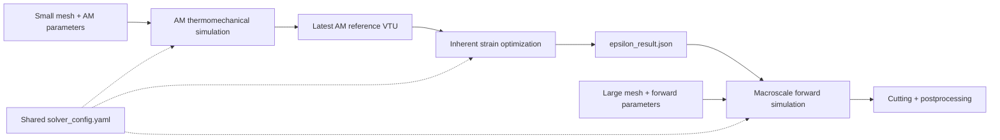

<p align="center">
  
</p>

<p align="center">
  <strong>Additive manufacturing · Inherent strain optimization · Residual stress &amp; distortion</strong>
</p>

<p align="center">
  <a href="https://dongdaoyang.github.io/"></a>
  
  
  
</p>

<p align="center">
  <a href="#simulation-gallery">Simulation gallery</a> ·
  <a href="#workflow">Workflow</a> ·
  <a href="#quick-start">Quick start</a> ·
  <a href="#configuration">Configuration</a> ·
  <a href="https://dongdaoyang.github.io/">Personal website</a>
</p>

**OPT-IS** connects a local thermomechanical AM simulation to inherent strain calibration and macroscale forward analysis. The workflow uses the AM fields as a reference, identifies an inherent strain vector on the same small mesh, and transfers that vector to a larger model for forward simulation, cutting, and postprocessing.

Explore the related benchmarks and research on my personal website, **[Residual Stress Hub](https://dongdaoyang.github.io/)**.

## Simulation gallery

<table>
  <tr>
    <td width="50%"></td>
    <td width="50%"></td>
  </tr>
  <tr>
    <td width="50%"></td>
    <td width="50%"></td>
  </tr>
</table>

These animations come from existing simulation recordings in the author's `opt_output/` directory: `single_track.avi`, `thin-wall.avi`, `cantilever.avi`, and `bridge.avi`. The original rendered frames and color legends are retained; playback is resampled for display and does not represent a physical-time scale. They illustrate archived runs; the checked-in workflow case is `cantilever`. See [media provenance](docs/media/sources.json) for source hashes and conversion details.

## Workflow



| Stage | Entry point | Role |
| :--- | :--- | :--- |
| AM | `am_solver/run.py` | Run thermomechanical scanning on the small mesh. |
| Optimization | `IS_solver/opt_run.py` | Fit `xx / yy / zz` inherent strain components to the AM reference, with optional `xx = yy` parameter tying. |
| Forward | `IS_solver/run.py` | Apply the calibrated vector to the large mesh; optionally release nodes for cutting and extract profiles. |
| Orchestration | `opt_solver/run.py` | Connect the stages, resolve inputs, generate effective configurations, and index the resulting artifacts. |

The optimizer and AM reference must use identical node and element counts and ordering. By default, the orchestrator selects the highest-numbered `step_*.vtu` from the AM output as the reference. It writes the calibrated vector into the forward configuration's `inherent_strain.default`.

## Quick start

Run commands from the repository root in a solver environment containing **NumPy, PyYAML, JAX, JAX-FEM, MeshIO, SciPy, and petsc4py**. Profile extraction also uses **PyVista**; plotting uses **Matplotlib**. The current PETSc policy requires the configured MUMPS, GAMG, and hypre support in your PETSc installation.

If using the author's existing Conda environment:

```bash
conda activate jax-fem-env
```

Check the case inputs and generate effective stage configurations without starting a solver:

```bash
python opt_solver/run.py cantilever --dry-run
```

Run the enabled workflow stages:

```bash
python opt_solver/run.py cantilever
```

Resume from a stage when its upstream results already exist:

```bash
python opt_solver/run.py cantilever --from-stage optimization
python opt_solver/run.py cantilever --from-stage forward
```

The dry run creates generated configurations and a workflow manifest in the configured output directory. A solver environment is still needed for the full computation.

## Configuration

### Case inputs

The checked-in case lives in [`opt_solver/cases/cantilever/`](opt_solver/cases/cantilever/).

| File | Purpose |
| :--- | :--- |
| [`config.yaml`](opt_solver/cases/cantilever/config.yaml) | Enabled stages, solver locations, mesh paths, output path, and reference unit conversion. |
| [`am.yaml`](opt_solver/cases/cantilever/am.yaml) | Thermal and mechanical AM settings, including temperature-dependent material parameters. |
| [`optimization.yaml`](opt_solver/cases/cantilever/optimization.yaml) | Inherent strain parameterization, objective, and optimization settings. |
| [`forward.yaml`](opt_solver/cases/cantilever/forward.yaml) | Macroscale activation, material, cutting, and profile extraction settings. |
| `mesh/Job-10020.inp` | Small mesh shared by AM and optimization. |
| `mesh/am25.inp` | Large mesh used by the forward stage. |

Copy the whole case directory to create a new case, then edit the copied inputs. The orchestrator requires case-specific stage YAML files, required input meshes, file-based toolpaths, and any explicit reference VTU to stay inside that case directory.

### Shared solver policy

All cases use the repository's [`solver_config.yaml`](solver_config.yaml). The orchestrator injects this policy after case overrides, so stage-specific solver settings cannot silently replace it. The standalone AM and IS entry points also load the shared policy.

| System | Current backend and method |
| :--- | :--- |
| AM thermal | PETSc `gmres` + `gamg`, with an enabled initial-temperature predictor. |
| AM mechanics | PETSc `preonly` + `lu`, using MUMPS. |
| Optimization forward and adjoint solves | PETSc `preonly` + `lu`, using MUMPS. |
| Macro forward | PETSc `gmres` + `hypre`. |
| Cutting | SciPy sparse direct solver, `spsolve`. |

Change solver strategies in `solver_config.yaml`; keep case YAML files focused on case inputs.

### Optional macro model

Set the following in the case's `config.yaml` to run AM and optimization only:

```yaml
run_macro_model: false
```

The default is `true` when omitted. With the macro model disabled, the workflow neither validates the large mesh nor generates the forward configuration, and `--from-stage forward` is unavailable. The checked-in cantilever case currently enables the macro model.

### Reference units

The example AM output stores displacement in **mm**, while optimization uses **m**, so the case sets:

```yaml
reference:
  displacement_scale_to_m: 0.001
```

Use `1.0` when the reference VTU already stores displacement in meters.

## Repository layout

```text
OPT-IS/
├── README.md                   # Project overview and workflow instructions
├── solver_config.yaml          # Shared solver policy
├── am_solver/                  # Thermomechanical AM solver
├── IS_solver/                  # Inherent strain optimization and forward solver
├── opt_solver/
│   ├── run.py                  # Workflow entry point
│   └── cases/cantilever/       # Case YAML files and input meshes
└── docs/media/                 # GIFs, project image, and sharing cover
```

## Outputs

The case configuration writes to `../opt_output/cantilever/`, beside the repository:

```text
Desktop/
├── OPT-IS/
└── opt_output/cantilever/
    ├── generated_configs/              # Effective configurations for enabled stages
    ├── am/vtk/                         # AM step fields
    ├── optimization/
    │   ├── epsilon_result.json         # Calibrated strain and optimization diagnostics
    │   └── vtk/                        # Optimized fields and reference error
    ├── forward/                        # Macro forward and cutting outputs, when enabled
    └── workflow_result.json            # Artifact paths and workflow status
```

Keep the repository and output directory in the same relative positions when moving them. Generated configurations and manifests may contain absolute paths; regenerate configurations after relocating the project. Source code, case configuration, and input meshes are versioned; full simulation outputs stay separate. Only the compact presentation assets in `docs/media/` are included here.

<details>
<summary><strong>Working across computers</strong></summary>

Before continuing work on another computer:

```bash
git pull --ff-only
```

After reviewing local changes:

```bash
git status
git add <files-you-changed>
git commit -m "Describe the changes"
git push
```

</details>
