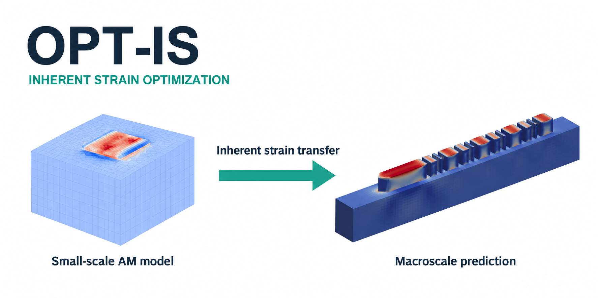
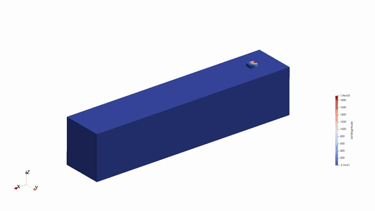
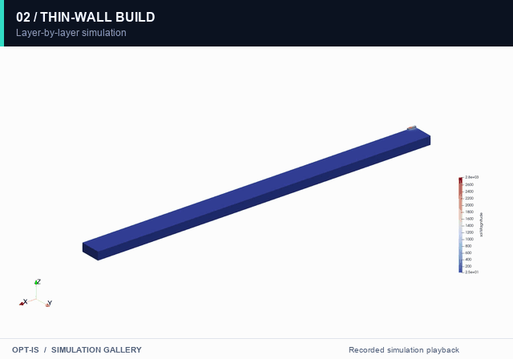
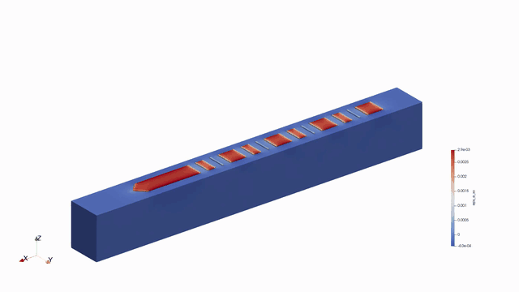
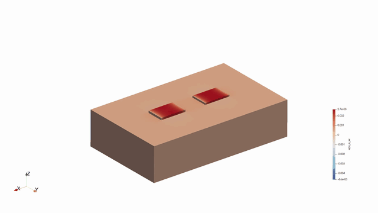
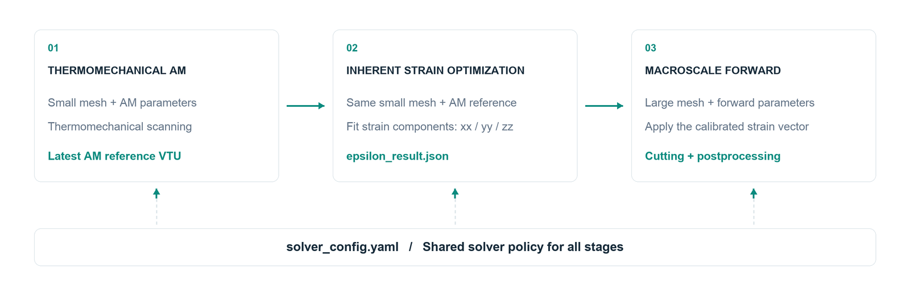

# Opt-IS

<p align="center">
  
</p>

<p align="center">
  <strong>Additive manufacturing · Inherent strain optimization · Residual stress &amp; distortion</strong>
</p>

**Opt-IS** is a finite element workflow for calibrating inherent strain from local additive manufacturing (AM) simulations and applying it to macroscale residual stress and distortion prediction. It connects thermomechanical process simulation, gradient-based parameter optimization, and structural analysis in one configurable pipeline.

Opt-IS is developed on top of [JAX-FEM](https://github.com/deepmodeling/jax-fem), using [JAX](https://github.com/jax-ml/jax) for automatic differentiation.

For related benchmark cases, modeling methods, and research resources on residual stress in metal additive manufacturing, visit [Residual Stress Hub](https://rshhub.github.io/).

A small-scale AM simulation provides the reference stress and displacement fields. The optimizer fits the inherent strain components on the same mesh, then transfers the calibrated vector to a larger model for forward analysis, cutting, and profile extraction. PETSc provides the configured linear solvers.

- **Local process simulation:** model thermal loading, material activation, and elastoplastic response during AM scanning.
- **Inherent strain calibration:** optimize the normal strain components `xx`, `yy`, and `zz`, with optional `xx = yy` tying, against reference fields in selected regions.
- **Macroscale prediction:** apply the calibrated strain to a larger mesh and evaluate the response before and after cutting.
- **Element activation and deactivation:** the inherent strain solver activates elements layer by layer to represent material addition during the build. For material removal, it supports element deactivation through progressive release of the selected elements' stress contribution, allowing the remaining structure to re-equilibrate. Both operations use element masks while retaining the original mesh.
- **Case-based execution:** manage meshes and stage settings through YAML files, share one solver policy, and resume from an existing stage result.

The repository includes **cantilever**, **dc** (double cantilever), **bridge**, and **dc2** workflow cases, together with standalone AM and inherent strain examples. Each case includes its YAML settings and input meshes. The gallery below shows archived simulation recordings.

## Simulation gallery

<p align="center">
  
</p>
<p align="center">
  <strong>Single-track scanning</strong><br>
  <em>Temperature evolution as a moving heat source scans a single track. The localized hot zone travels along the scan path while heat diffuses into the substrate.</em>
</p>

<p align="center">
  
</p>
<p align="center">
  <strong>Thin-wall build</strong><br>
  <em>Thermal simulation of a thin wall built through successive scanning passes. The animation shows localized heating and cooling as the build progresses.</em>
</p>

<p align="center">
  
</p>
<p align="center">
  <strong>Cantilever</strong><br>
  <em>Evolution of axial elastic strain (eps_e_xx) in a cantilever build. The field shows the spatial variation of elastic strain across the part and its supporting structure.</em>
</p>

<p align="center">
  
</p>
<p align="center">
  <strong>Bridge</strong><br>
  <em>Evolution of axial elastic strain (eps_e_xx) in a bridge-shaped build. The animation follows the strain distribution as the two supports and connecting span take shape.</em>
</p>

Archived simulations of single-track scanning, a thin-wall build, a cantilever, and a bridge. The original field legends are retained; animation playback does not represent physical time. Recording sources and conversion details are documented in [media provenance](docs/media/sources.json).

## Workflow



| Stage | Entry point | Role |
| :--- | :--- | :--- |
| AM | `am_solver/run.py` | Run thermomechanical scanning on the small mesh. |
| Optimization | `IS_solver/opt_run.py` | Fit `xx / yy / zz` inherent strain components to the AM reference, with optional `xx = yy` parameter tying. |
| Forward | `IS_solver/run.py` | Apply the calibrated vector to the large mesh; optionally release nodes for cutting and extract profiles. |
| Workflow launcher | `workflow/run.py` | Connect the stages, resolve inputs, generate effective configurations, and index the resulting artifacts. |

`workflow/` is the workflow launcher and case library. The numerical solvers live in `am_solver/` and `IS_solver/`.

The optimizer and AM reference must use identical node and element counts and ordering. By default, the orchestrator selects the highest-numbered `step_*.vtu` from the AM output as the reference. It writes the calibrated vector into the forward configuration's `inherent_strain.default`.

## Quick start

Run commands from the repository root in a solver environment containing **NumPy, PyYAML, JAX, JAX-FEM, MeshIO, SciPy, and petsc4py**. Profile extraction also uses **PyVista**; plotting uses **Matplotlib**. The current PETSc policy requires the configured MUMPS, GAMG, and hypre support in your PETSc installation.

Activate your solver environment before running the workflow. For an environment named `jax-fem-env`:

```bash
conda activate jax-fem-env
```

Check the case inputs and generate effective stage configurations without starting a solver:

```bash
python workflow/run.py cantilever --dry-run
python workflow/run.py dc --dry-run
python workflow/run.py bridge --dry-run
python workflow/run.py dc2 --dry-run
```

Run the enabled workflow stages:

```bash
python workflow/run.py cantilever
```

Resume from a stage when its upstream results already exist:

```bash
python workflow/run.py cantilever --from-stage optimization
python workflow/run.py cantilever --from-stage forward
```

The dry run checks input paths and generates stage configurations and a workflow manifest without running the simulation. Its forward configuration uses the initial strain parameters; a full run replaces them with the calibrated values. The dry run itself only requires Python and PyYAML.

## Configuration

### Case inputs

The workflow cases live in [`workflow/cases/`](workflow/cases/). Their supplied stage selections are preserved:

| Case | Material / setup | Enabled stages | Main macro mesh |
| :--- | :--- | :--- | :--- |
| [`cantilever`](workflow/cases/cantilever/) | IN625 cantilever | AM → optimization → forward / cutting | `am25.inp` |
| [`dc`](workflow/cases/dc/) | Double cantilever | AM → optimization | `dc36.inp` |
| [`bridge`](workflow/cases/bridge/) | Ti-6Al-4V bridge | AM → optimization → forward | `arc36.inp` |
| [`dc2`](workflow/cases/dc2/) | Ti-6Al-4V double-cantilever variant | AM → optimization | `dc36.inp` |

The `dc` and `dc2` cases include forward configurations and macro meshes; set `run_macro_model: true` in their `config.yaml` to include that stage. Alternative macro meshes are retained in each case's `mesh/` directory.

Each workflow case has the same structure; the cantilever files provide an example:

| File | Purpose |
| :--- | :--- |
| [`config.yaml`](workflow/cases/cantilever/config.yaml) | Enabled stages, solver locations, mesh paths, output path, and reference unit conversion. |
| [`am.yaml`](workflow/cases/cantilever/am.yaml) | Thermal and mechanical AM settings, including temperature-dependent material parameters. |
| [`optimization.yaml`](workflow/cases/cantilever/optimization.yaml) | Inherent strain parameterization, objective, and optimization settings. |
| [`forward.yaml`](workflow/cases/cantilever/forward.yaml) | Macroscale activation, material, cutting, and profile extraction settings. |
| `mesh/Job-10020.inp` | Small mesh shared by AM and optimization. |
| `mesh/am25.inp` | Large mesh used by the forward stage. |

Copy the whole case directory to create a new case, then edit the copied inputs. The orchestrator requires case-specific stage YAML files, required input meshes, file-based toolpaths, and any explicit reference VTU to stay inside that case directory.

### Standalone examples

| Entry point | Included cases | Purpose |
| :--- | :--- | :--- |
| `am_solver/run.py` | [`track1`](am_solver/cases/track1/), [`thin_wall`](am_solver/cases/thin_wall/), [`dc_scan`](am_solver/cases/dc_scan/), [`point_heat`](am_solver/cases/point_heat/) | Single-track, thin-wall, hatch scanning, and thermal-only point-source examples. |
| `IS_solver/run.py` | [`can`](IS_solver/cases/can/), [`dc`](IS_solver/cases/dc/), [`bg`](IS_solver/cases/bg/) | Standalone cantilever, double-cantilever, and bridge analyses with prescribed inherent strain. |

For example:

```bash
python am_solver/run.py track1
python am_solver/run.py am_solver/cases/thin_wall/thin_wall20.yaml
python am_solver/run.py point_heat
python IS_solver/run.py can
```

The thermal-only `point_heat` example uses its case-local thermal solver settings. The other AM and IS examples load the shared solver policy. Standalone IS cases prescribe their own strain values; the workflow cases perform calibration before macro analysis.

### Shared solver policy

Workflow cases use the repository's [`solver_config.yaml`](solver_config.yaml). The orchestrator injects this policy after case overrides, so stage-specific solver settings cannot silently replace it. The standalone AM and IS entry points also load the shared policy, except for the thermal-only benchmark described above.

| System | Current backend and method |
| :--- | :--- |
| AM thermal | PETSc `gmres` + `gamg`, with an enabled initial-temperature predictor. |
| AM mechanics | PETSc `preonly` + `lu`, using MUMPS. |
| Optimization forward and adjoint solves | PETSc `preonly` + `lu`, using MUMPS. |
| Macro forward | PETSc `gmres` + `hypre`. |
| Cutting | SciPy sparse direct solver, `spsolve`. |

Change solver strategies in `solver_config.yaml`; keep case YAML files focused on case inputs.

### Optional macro model

Set the following in the case's `config.yaml` to run AM and optimization only:

```yaml
run_macro_model: false
```

The default is `true` when omitted. With the macro model disabled, the workflow neither validates the large mesh nor generates the forward configuration, and `--from-stage forward` is unavailable. The supplied cantilever and bridge configurations enable the macro model; dc and dc2 disable it.

### Reference units

The example AM output stores displacement in **mm**, while optimization uses **m**, so the case sets:

```yaml
reference:
  displacement_scale_to_m: 0.001
```

Use `1.0` when the reference VTU already stores displacement in meters.

### Optimization results

The cantilever case uses L-BFGS-B with `xx = yy` and an independent `zz` component. Its objective combines normal stress, a von Mises measure computed from the diagonal stress components, top-surface vertical displacement, and in-plane relative contraction. Parameter bounds, objective weights, and regions of interest are configured in `optimization.yaml`.

Review `optimization/epsilon_result.json` for the fitted vector and convergence diagnostics. The example sets `stages.optimization.require_success: false`, so the forward stage can use the current best vector even if the optimizer reaches its iteration limit. Set this to `true` in the case's `config.yaml` to require successful convergence before proceeding.

## Repository layout

```text
Opt-IS/
├── README.md                   # Project overview and workflow instructions
├── solver_config.yaml          # Shared solver policy
├── am_solver/                  # Thermomechanical AM solver and standalone cases
├── IS_solver/                  # Inherent strain optimization, forward solver, and cases
├── workflow/
│   ├── run.py                  # Workflow launcher
│   └── cases/                 # YAML settings and input meshes
│       ├── cantilever/
│       ├── dc/
│       ├── bridge/
│       └── dc2/
└── docs/media/                 # README cover, workflow diagram, GIFs, and project icon
```

## Outputs

The case configuration writes to `../opt_output/cantilever/`, beside the repository:

```text
Desktop/
├── Opt-IS/
└── opt_output/cantilever/
    ├── generated_configs/              # Effective configurations for enabled stages
    ├── am/vtk/                         # AM step fields
    ├── optimization/
    │   ├── epsilon_result.json         # Calibrated strain and optimization diagnostics
    │   └── vtk/                        # Optimized fields and reference error
    ├── forward/                        # Macro forward and cutting outputs, when enabled
    └── workflow_result.json            # Artifact paths and workflow status
```

Keep the repository and output directory in the same relative positions when moving them. Generated configurations and manifests may contain absolute paths; regenerate configurations after relocating the project. Source code, case configuration, and input meshes are versioned; full simulation outputs stay separate. Only the compact presentation assets in `docs/media/` are included here.
